# SimpleSkills Enhanced

**SimpleSkills Enhanced** is a community-developed fork of the original [SimpleSkills](https://modrinth.com/mod/simpleskills) Fabric mod, introducing additional RPG mechanics, profession bonuses, combat improvements, fishing mechanics, and interface enhancements.

> [!IMPORTANT]
> **Original Mod Credits**
>
> SimpleSkills Enhanced is a **fork** of the official SimpleSkills mod. The entire foundation of the mod, including its skill system, leaderboards, Ironman mode, configuration, and original concept, belongs to its creator, **obyekt** (Discord: `obyekt`).
>
> All credit for the original work goes to its creator. This fork builds upon his work by introducing additional improvements.
>
> If you enjoy this project, please support the original author and check out the official mod:
>
> - [Modrinth — SimpleSkills](https://modrinth.com/mod/simpleskills)
> - [GitHub — obujekuto/simpleskills](https://github.com/obujekuto/simpleskills)
> - [Buy Me a Coffee — obujekuto](https://www.buymeacoffee.com/obujekuto)

---

## 🏆 Progression Philosophy

The perks in SimpleSkills exist to reward players for the time they invest in their professions.

Reaching level 99 requires significant dedication, so achieving the maximum level should feel worthwhile. Players who reach this milestone earn the full benefits of their profession, with bonuses intentionally tuned to become powerful at higher levels.

## ✨ What SimpleSkills Enhanced Adds

### ⛏️ Mining, 🪓 Woodcutting & 🥄 Excavating

#### Gathering Speed

- **+1% block-breaking speed per level**, reaching **+99% at level 99**.
- Bonuses respect the appropriate tool for each profession:
  - **Mining:** Pickaxe.
  - **Woodcutting:** Axe.
  - **Excavating:** Shovel.
- Bonuses multiply vanilla block-breaking speed instead of replacing the original calculation.
- **Tool Durability Protection:** +1 percentage point per level, up to **99% at level 99**.

#### Loot Duplication (Mining & Woodcutting)

- +5 percentage points of duplication chance every 10 levels.
- Maximum duplication chance: **45% at level 90**.

### ⛏️ Mining

#### Vein Mining

- Unlocked at level 15.
- Hold **Shift** to mine connected blocks of the same ore type.
- Every 15 levels adds 2 extra blocks.
- Reaches **12 additional blocks at level 90**.

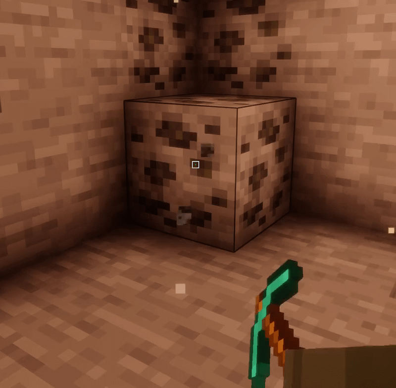

### 🪓 Woodcutting

#### Tree Feller

- Unlocked at level 5.
- Hold **Shift** and break a tree trunk with an axe to make the connected tree fall, including its branches and leaves.
- Fallen logs and leaves have animations.
- Leaves generate their normal drops when they land.

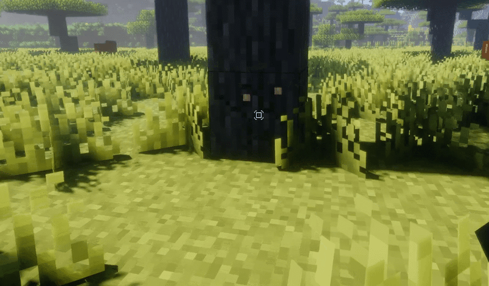

### 🥄 Excavating

#### Sand Investigation

- Hold right-click with a shovel on Sand to investigate it and search for buried treasures.
- **Investigation Speed:** Decreases with skill level, from **3 seconds at level 1** to **1 second at level 99**.
- Investigation progress, completion, cancellation, loot generation, and XP rewards are controlled server-side.
- Investigations are canceled if the player:
  - Changes the target block.
  - Changes the shovel being held.
  - Changes the selected hotbar slot.
  - Changes dimension.
  - Moves too far away.
  - Stops holding the interaction.
- Only one player can investigate the same Sand block at a time.
- Canceled investigations do not grant XP or loot, consume no durability, and leave the original Sand block untouched.

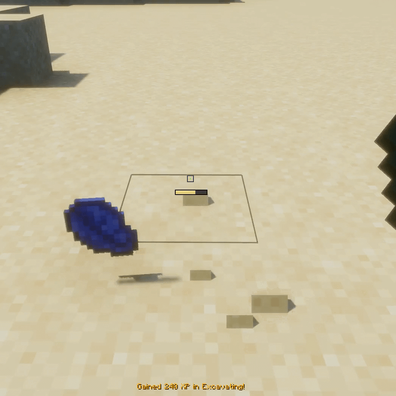

#### Ranks & Progression

- **10 unique ranks**, each with its own name and color.
- Progression unlocks access to increasingly valuable rewards.
- Rank-up notifications announce newly reached ranks.

| Rank | Level Range |
|:--|:--:|
| Novice Digger | 1–10 |
| Sand Seeker | 11–20 |
| Treasure Scout | 21–30 |
| Relic Hunter | 31–40 |
| Gold Prospector | 41–50 |
| Expert Excavator | 51–60 |
| Treasure Tracker | 61–70 |
| Master Prospector | 71–80 |
| Legendary Digger | 81–90 |
| Legendary Treasure Hunter | 91–99 |

#### Loot System

- **28 possible rewards** distributed across 7 rarity tiers:
  - Common
  - Uncommon
  - Rare
  - Very Rare
  - Epic
  - Legendary
  - Mythic
- Reward chances and rarity budgets scale with skill level.
- Rewards within each rarity share its budget according to their relative weights.
- The chance of finding Nothing is calculated dynamically based on available rarity budgets.
- The complete loot distribution, including Nothing, always totals **100%**.
- Each completed investigation performs a single loot roll.
- Enchanted Books are generated using valid loot enchantments, excluding curses.
- Pottery Sherds are selected from the vanilla pottery sherd tag.

#### XP Rewards

Every completed investigation grants **40 base XP**, even when Nothing is found. Additional XP depends on the rarity of the discovered reward.

| Discovery | Total XP |
|:--|--:|
| Nothing | 40 |
| Common | 140 |
| Uncommon | 190 |
| Rare | 240 |
| Very Rare | 340 |
| Epic | 540 |
| Legendary | 840 |
| Mythic | 1540 |

#### Special Discoveries

- Very Rare and higher-tier discoveries trigger chat notifications.
- Legendary and Mythic discoveries also trigger special sound and particle effects.

#### Investigated Sand

- Completed investigations transform Sand into a special block: `simpleskills:investigated_sand`.
- Uses the vanilla Sand texture and matching block properties.
- Retains vanilla-like gravity, breaking behavior, drops, and placement.
- Investigated Sand cannot be investigated again.
- Integrated into relevant sand, glass, and shovel tags.
- Includes **18 additional recipes** for sandstone, TNT, and concrete powder.

#### Shared Gathering Bonuses

- Excavating uses the shared **Gathering Speed** and **Tool Durability Protection** bonuses.
- The appropriate tool for Excavating is the Shovel.

### 🎣 Fishing

#### Real-Time Fishing Minigame

- Replaces the vanilla random fishing-bite process with a minigame driven by real fish entities in the world.
- Supports **Cod, Salmon, Tropical Fish, and Pufferfish**.
- The actual fish species determines the main fish item delivered after a successful catch.
- Fishing sessions progress through five stages:

  **Settling → Waiting → Approaching → Biting → Fighting**

- Fish swim toward the bait before biting.
- The player must right-click during the bite window to start the fight.
- During the fight, fish pull left, pull right, or pause.
- Players counter their movement by turning the camera in the opposite direction and reel using the use key.
- The HUD displays:
  - Line tension.
  - Fish fatigue.
  - Reeling progress.
  - Fish movement.
- Excessive line tension breaks the fishing line.
- Failed catches allow the fish to escape without rewards.
- Fish can react to nearby players through configurable hearing and vision behavior.
- Fish movement is controlled during an active fishing session and returns to normal AI when the session ends.

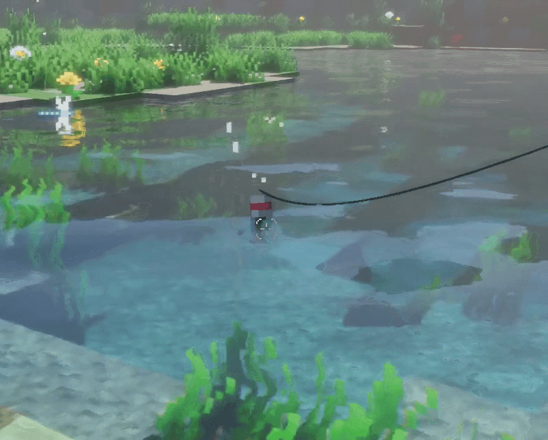

#### Individual Fish Attributes — Weight & Length

Every caught fish has its own individual physical characteristics.

- Each fish receives individual **weight and length attributes**.
- These attributes make catches more varied: two fish of the same species can have different sizes and weights.
- Fish attributes are associated with the individual fish rather than being fixed values for the entire species.
- Supported fish include Cod, Salmon, Tropical Fish, and Pufferfish.
- Tropical Fish variants are also supported.

#### Size-Based Fishing Difficulty

A fish's physical characteristics directly influence how difficult it is to catch.

- Larger and heavier fish are generally stronger and more difficult to land.
- Fish weight and size influence the strength of the fish during the fighting stage.
- Stronger fish create a greater challenge when countering their movements and managing line tension.
- Smaller and lighter fish are generally easier to catch.
- The fishing fight therefore depends not only on the species, but also on the individual characteristics of the fish.

#### Size-Based Fishing XP

Fishing XP is calculated using the individual characteristics of the caught fish.

- The fish's weight and length influence the XP awarded after a successful catch.
- Larger and heavier catches can reward more Fishing XP.
- Smaller catches generally provide less XP.
- XP scaling uses a square-root-based size calculation.
- Size-based XP scaling is clamped between **0.6× and 2.0×**.
- The maximum reward is capped at **3× the base XP**.
- The final XP reward is calculated server-side and integrated into the normal Fishing skill progression.
- The actual XP awarded is displayed on the fishing catch results screen.

#### Fishing Catch Results Screen

After successfully catching a fish, a new results screen displays information about the catch.

The screen includes:

- **The caught fish:** Displays the actual fish visually.
- **Weight:** Shows the individual weight of the fish.
- **Length:** Shows the individual length of the fish.
- **Fishing XP:** Displays the XP awarded for that catch.

The results screen makes each successful fishing session more rewarding by showing the characteristics of the fish and the experience gained.

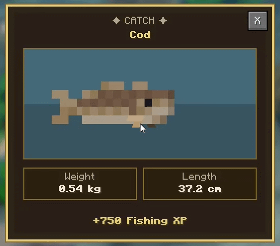

#### Fishing Ecosystem

- Validates fishing locations using connected water volume and water depth.
- Searches for eligible fish already present in the environment before replenishing the local population.
- Can discreetly spawn supported fish when the local population is below the configured target.
- Spawn positions are selected away from the bait and player, with preference for deeper water and locations outside the player's field of view.
- Small puddles, shallow water, and locations without sufficient connected water are rejected.
- The configured minimum fish count is a replenishment target, not a strict requirement.
- Fishing can proceed when at least one eligible fish is available.

#### Supported Fish Species

| Species | Pull Strength | Fatigue Factor | XP Multiplier | Default Minimum Level |
|:--|--:|--:|--:|--:|
| Cod | 1.00× | 1.00× | 1.00× | 1 |
| Salmon | 1.20× | 0.85× | 1.15× | 1 |
| Tropical Fish | 0.85× | 1.15× | 1.30× | 1 |
| Pufferfish | 1.10× | 0.90× | 1.50× | 25 |

#### Fishing Progression

Fishing levels improve several aspects of the minigame:

- **Fish Attraction Speed:** Up to +150% at level 99, allowing fish to approach the bait up to 2.5× faster.
- **Fish Fatigue:** Up to +100% at level 99, making fish tire up to twice as fast.
- **Line Tension Control:** Reduces tension growth by up to 40% at level 99.
- **Line Recovery:** Increases recovery speed by up to 100% at level 99.

These bonuses can be individually configured.

#### Fishing Rewards

- Successfully caught fish are delivered as their corresponding fish items.
- Each successful catch performs a single bonus-loot roll.
- Bonus loot can include junk and treasure.
- Fish-category rewards are excluded because the main fish is already delivered separately.
- The custom rank-based fishing loot table is used when available and enabled.
- Vanilla fishing loot can be used as a fallback when the custom loot table is unavailable or disabled.
- Successful catches grant Fishing XP based on configured catch XP, the caught species' XP multiplier, and the individual fish's size and weight.
- Successful catches consume 1 fishing rod durability point.
- Escaped fish grant no catch rewards or XP.
- When the fishing line breaks, the configured durability penalty is applied.

#### Fishing Diagnostics

Use the following command to toggle detailed fishing diagnostics for your player:

```text
/simpleskills fishing debug
```

Diagnostic messages help investigate:

- Fishing spot validation.
- Fish selection and rejection.
- Fish approach.
- Bite timing.
- Fight behavior.

### ⚔️ Slaying

- **Sword Damage:** +0.3% per level, up to **+29.7% at level 99**.
- **Critical Hit Chance:** +0.5 percentage points per level, up to **49.5% at level 99**.
- **Custom Critical Hits:** Deal **1.5× damage**.
- **Vanilla Critical Compatibility:** Vanilla critical hits triggered while falling or jumping remain fully functional. A vanilla critical and a SimpleSkills critical can trigger simultaneously on the same hit.
- **Life Steal I (Level 50):** 30% chance to recover half a heart.
- **Life Steal II (Level 99):** 60% chance to recover half a heart.
- Bonuses apply to **swords** when performing charged attacks.

### 🏹 Ranged

- **Projectile Damage:** +0.5% per level, up to **+49.5% at level 99**.
- **Double Shot (Levels 1–50):** +2 percentage points of duplication chance per level, reaching 100% at level 50.
- **Triple Shot (Levels 51–99):** Once Double Shot is guaranteed, a second extra projectile can be created. Its chance progressively increases from 0% at level 50 to 100% at level 99.
- **Maximum Projectiles:** Up to 3 projectiles per shot at level 99 (the original projectile plus 2 duplicates).
- **Eligible Weapons:** Bows and Crossbows.
- **Arrow Duplication:** Works with both Bows and Crossbows.
- **Firework Rocket Duplication:** Works exclusively with Crossbows.
- **Multishot Compatibility:** Each projectile has its own independent chance to trigger duplication.
- **Free Duplication:** Extra projectiles consume no additional ammunition and grant no additional skill XP.
- **Projectile Trajectory:** Duplicated projectiles follow the original shot direction and spawn at randomized positions around the original projectile.

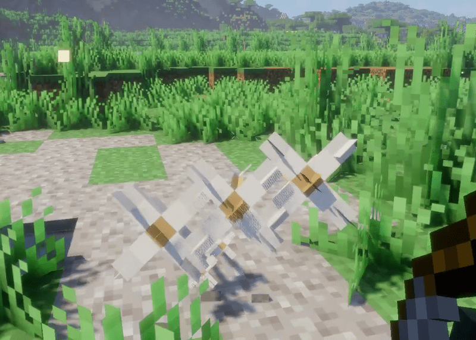

### 🛡️ Defense

- **Damage Reduction:** +0.3 percentage points per level, up to **29.7% at level 99**.
- **Armor Durability Protection:** +1 percentage point per level, up to **99% at level 99**.
- **Knockback Resistance:** +0.5 percentage points per level, up to **49.5% at level 99**.

### 🌾 Farming

SimpleSkills Enhanced expands Farming with additional harvesting bonuses, animal loot mechanics, and two unlockable farming perks.

#### Farming Bonuses

- **Harvest Bonus:** +1 percentage point of extra harvest drop chance per level, reaching **+99% at level 99**.
- **Animal Loot Bonus:** +1 percentage point of extra loot chance per level, reaching **+99% at level 99**.
- Animal Loot Bonus applies to extra drops when killing farm animals and to additional wool when shearing sheep.
- Both mechanics use the same Animal Loot Bonus chance.
- Tamable animals are excluded from the extra loot mechanic when killed.

#### Farming XP Improvements

- **Milking XP:** Successfully milking cows and mooshrooms grants Farming XP.
- Milking XP can be configured through the optional `milk_cow` action key in `farming_xp.json`.
- If `milk_cow` is omitted, the base Farming XP value is used.

#### Farming Perks

Both perks unlock at **Farming Level 5**.

# Bone Meal Mastery

- Use any hoe and right-click a compatible crop to accelerate its growth without consuming Bone Meal.
- Hunger cost decreases as Farming level increases:

| Farming Level | Hunger Cost |
|:--|--:|
| 5–9 | 2 bars |
| 10–14 | 1.5 bars |
| 15–19 | 1 bar |
| 20+ | Free |

- Hunger is consumed only when the crop successfully grows.

# Auto Plant

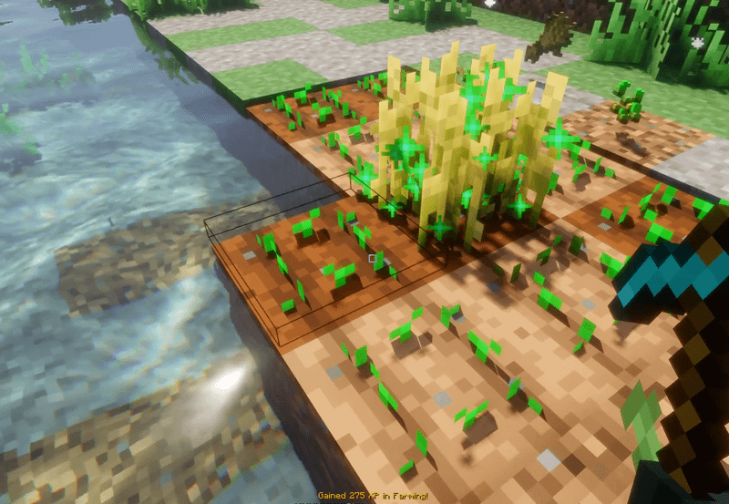

**Auto Plant**

- Use any hoe and left-click a fully grown crop on farmland to harvest and automatically replant it.
- Replanting uses matching seeds from the harvested crop's drops when available.
- If no matching seed is dropped, the crop is still replanted without consuming an item.
- Supports compatible crops, including modded crops where applicable.
- Only fully grown crops can be harvested using this perk.
- Stems and double-block crops are excluded from Auto Plant.

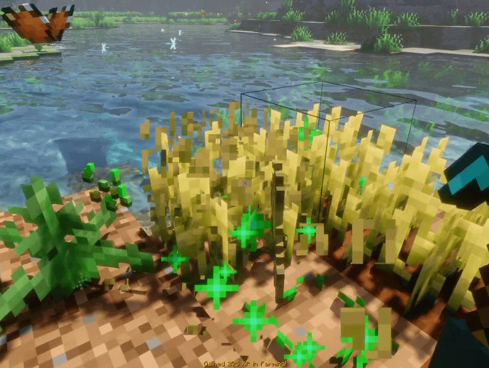

### ✨ Enchanting

SimpleSkills Enhanced completely overhauls the vanilla enchanting system, replacing the standard RNG table with an interactive, skill-based minigame.

#### Rune Ores
- Added **Rune Ore** and **Deepslate Rune Ore** to Overworld generation.
- Mining these ores drops **Runes**, which are required for the new Enchanting system.
- Grants significant Mining XP (900 XP for Rune Ore, 1100 XP for Deepslate Rune Ore).

#### Rune Infusion Minigame
- Interacting with an Enchanting Table now opens the **Rune Infusion** menu.
- **No XP or Lapis Cost:** Enchanting now exclusively costs **Runes** (1 Rune per selected enchantment).
- Select up to **4 compatible enchantments** to apply to your equipment at once.

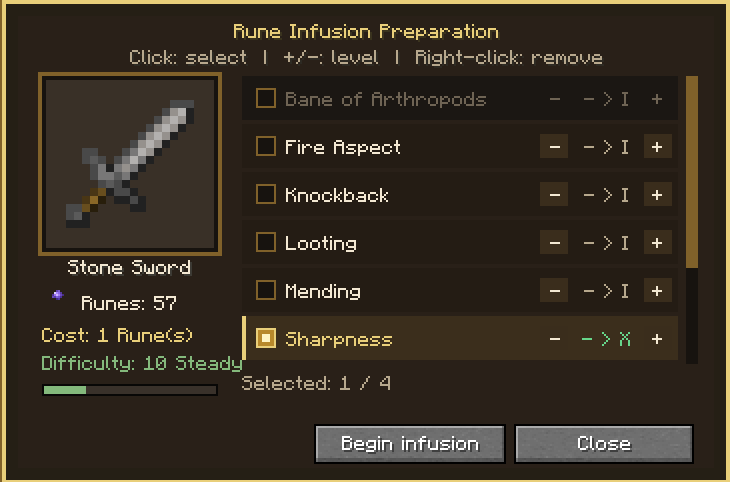

- **Interactive Gameplay:** You must stabilize the magical energy. Cracks will appear on the item interface—hold your click on these cracks to repair them before they drain the equipment's integrity.
- **Difficulty Scaling:** The speed and frequency of cracks depend on the combined levels of the enchantments you selected (from Calm to Chaotic).
- **Grading System:** Your performance is graded at the end of the infusion (Poor, Fair, Good, Excellent, Perfect). Higher grades give you a chance to receive a **bonus enchantment level** for free!

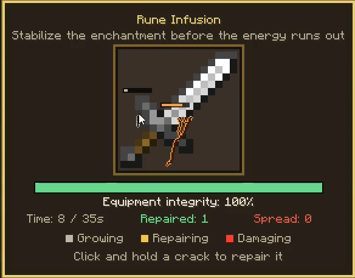

#### Over-level Enchanting & Progression
- Progression directly unlocks higher enchantment tiers. Every 10 levels generally unlock the next tier (e.g., Level 10-19 unlocks Tier II, Level 90-99 unlocks Tier X).
- Bypasses vanilla enchantment caps: Supported enchantments can scale far beyond their normal limits (e.g., Sharpness X), fully configurable via `enchantment_limits.json`.
- **Anvil Integration:** The Anvil respects your current Enchanting profession level and the new configured caps, allowing you to combine books up to your newly unlocked limits.

#### Ranks & Progression
- **10 unique ranks** for the Enchanting profession.

| Rank | Level Range |
|:--|:--:|
| Rune Novice | 1–10 |
| Rune Initiate | 11–20 |
| Glyph Scribe | 21–30 |
| Sigil Adept | 31–40 |
| Spellweaver | 41–50 |
| Rune Binder | 51–60 |
| Arcane Infuser | 61–70 |
| Master Runesmith | 71–80 |
| Grand Runecaster | 81–90 |
| Archmage of Runes | 91–99 |

### 🖥️ HUD & Interface

#### Skills HUD

- Refreshed visual appearance.
- Removed the original yellow border.

#### Reworked TAB Menu — SkillTabMenu

- Currently displayed exclusively on the multiplayer player TAB screen.
- Shows the benefits of each profession.
- Displays progression information and per-level bonuses.
- Improved visual organization of skill information.

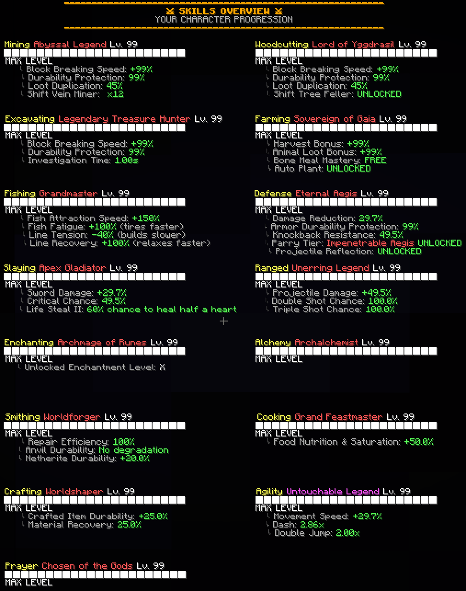

#### ⚖️ Rebalanced Gear Progression

During testing with a small group of 3–4 players, I noticed that the original equipment requirements were making progression feel too slow. Players were getting discouraged by how long it took to unlock Iron and Diamond equipment.

To address this, I rebalanced the equipment requirements to make progression more rewarding and accessible, while keeping skill levels meaningful and preserving a sense of advancement.

| Armor | Defense Level | Tool | Tool Level |
|:--|--:|:--|--:|
| Leather | 0 | Wood | 0 |
| Gold | 0 | Gold | 5 |
| Copper | 5 | Stone | 10 |
| Turtle Helmet | 15 | Copper | 15 |
| Chainmail | 15 | Iron | 25 |
| Iron | 20 | Diamond | 30 |
| Diamond | 25 | Netherite | 35 |
| Netherite | 30 | — | — |

#### Additional Equipment Requirements

- **Shields:** Defense level 5.
- **Weapons:**
  - Mace: Level 35.
  - Crossbow: Level 10.
  - Bow: Level 0.
  - Trident: Level 30.
- **Elytra:** Prayer level 25.
- Affected items display their requirements in their item lore (e.g., `Requires level 25 Defense`).
- All requirements can be customized through `tool_requirements.json` and `armor_requirements.json`.

---

## 📜 Original SimpleSkills Features

Everything described in this section belongs to the original **SimpleSkills** mod, created by **obyekt**.

SimpleSkills is a **server-side Fabric mod** that transforms Minecraft into an RPG experience with 15 skills, unlockable equipment, leaderboards, and progression up to level 99.

It works in multiplayer without requiring players to install the mod on their clients. For singleplayer, install it on the client.

### Default Controls

| Key | Function |
|:--|:--|
| `TAB` | Toggle the HUD. |
| `J` | Move the HUD. |

Keys can be rebound in Minecraft's Controls menu.

### ⭐ Main Features

- **15 Skills:** From Mining to Prayer, each with its own progression and benefits.
- **Gear Unlocks:** Diamond, Netherite, and other equipment unlocked according to skill levels.
- **Ironman Mode:** Lose items and XP upon death, with reduced HP (-50%) and 0.2× XP gain. Includes a red skull icon and server death announcement. Can be enforced for all players.
- **Leaderboards:** Top 5 rankings for individual skills or total levels, including an Ironman-exclusive leaderboard. XP continues to be tracked after level 99.
- **Prestige System:** Reach maximum level in all skills to reset progression and earn a Prestige counter next to your name.
- **Natural Economy:** High-level players can provide services such as enchanting, cooking, and crafting.
- **Fully Customizable:** JSON configuration with live reloading through `/simpleskills reload`, without restarting the server.
- **Vanilla+ Experience:** Simple, intuitive, and unobtrusive gameplay.

### 🛠️ The 15 Skills

| Skill | Description |
|:--|:--|
| Mining | Break stone and ores to unlock better tools. |
| Woodcutting | Chop trees. |
| Excavating | Dig dirt, sand, and gravel. |
| Farming | Till, compost, shear, milk, feed, breed animals, and harvest crops. |
| Fishing | Fish faster and unlock better loot. |
| Defense | Take armor hits to unlock better equipment. |
| Slaying | Improve melee combat progression. |
| Ranged | Use bows, crossbows, and tridents. |
| Enchanting | Unlock level-restricted enchantments at the anvil. |
| Alchemy | Brew potions with extended durations. |
| Smithing | Repair and upgrade equipment. |
| Cooking | Prepare meals that restore more hunger and saturation. |
| Crafting | Create more durable tools and armor, with a chance to recover materials. |
| Agility | Run, jump, and swim faster. |
| Prayer | Sacrifice rare items to obtain long-lasting buffs. |

### ⚒️ Original Skill Highlights

#### Mining, Excavating & Woodcutting

- XP is calculated based on block hardness and the required tool.
- Block XP overrides can be configured through `block_mappings.json`.
- Ores mined using Silk Touch grant no XP.

#### 🍖 Cooking

Hunger and saturation multipliers based on skill tier:

| Tier | Multiplier |
|:--|--:|
| Novice | 0.875× |
| Journeyman | 1× |
| Artisan | 1.125× |
| Expert | 1.25× |
| Grandmaster | 1.5× |

- Customizable XP tables encourage players to prepare a variety of foods, including Rabbit Stew, Golden Apple, Pumpkin Pie, and more.

#### 🧪 Alchemy

Potion duration multipliers:

| Tier | Multiplier |
|:--|--:|
| Novice | 1× |
| Journeyman | 1.25× |
| Artisan | 1.5× |
| Expert | 1.75× |
| Grandmaster | 3× |

#### 🧰 Crafting

Durability and ingredient recovery bonuses:

| Tier | Durability Bonus | Ingredient Recovery |
|:--|--:|--:|
| Novice | 0% | 0% |
| Journeyman | 5% | 2.5% |
| Artisan | 10% | 5% |
| Expert | 15% | 7.5% |
| Grandmaster | 25% | 15% |

- Crafted items are signed with the player's name and rank.

#### 🔨 Smithing

Repair bonuses per tier:

| Tier | Repair Bonus |
|:--|--:|
| Novice | 25% |
| Journeyman | 35% |
| Artisan | 45% |
| Expert | 55% |
| Grandmaster | 100% |

- Anvils no longer take damage when repairing items.

Diamond-to-Netherite upgrade durability bonuses:

| Tier | Durability Bonus |
|:--|--:|
| Novice | 0% |
| Journeyman | 5% |
| Artisan | 7.5% |
| Expert | 10% |
| Grandmaster | 20% |

- Smithing bonuses stack with Crafting bonuses.

#### 🙏 Prayer

- Sacrifice rare items by right-clicking a lit candle.
- Five buff tiers, lasting from 1 to 8 hours.
- Examples:
  - Rabbit Foot → Luck.
  - Diamond → Speed II.
  - Totem of Undying → Invisibility.
  - Nether Star → Haste II.
- All sacrifices and buffs are fully customizable.

---

## 💻 Commands

### Players

| Command | Description |
|:--|:--|
| `/simpleskills togglehud` | Toggle the skills HUD. |
| `/simpleskills ironman enable` | Enable Ironman mode. |
| `/simpleskills reset` | Reset your skills. |
| `/simpleskills leaderboard <skill\|total>` | View the regular leaderboard. |
| `/simpleskills leaderboardironman <skill\|total>` | View the Ironman leaderboard. |
| `/simpleskills query <username> <skill\|total>` | Query a player's skill progression. |
| `/simpleskills fishing debug` | Toggle detailed fishing minigame diagnostics for your player. |

### Administrators & Moderators

| Command | Description |
|:--|:--|
| `/simpleskills reload` | Reload configuration files. |
| `/simpleskills reset <username>` | Reset a player's progression. |
| `/simpleskills addxp <username> <skill> <amount>` | Add XP to a player's skill. |
| `/simpleskills setlevel <username> <skill> <level>` | Set a player's skill level. |
| `/simpleskills excavating odds <level>` | Display the exact Excavating loot distribution for a level from 1 to 99. |

---

## ⚙️ Configuration

Configuration files are located in:

```text
server_root/config/simpleskills
```

Customize XP progression, unlock requirements, loot tables, Prayer sacrifices, and Ironman difficulty.

### Ironman Configuration

Important Ironman configuration options:

```json
{
  "standard_xp_multiplier": "...",
  "ironman_xp_multiplier": "..."
}
```


## 🚀 Installation

1. Install **Fabric Loader** and **Fabric API** for the supported Minecraft version.
2. Download the SimpleSkills Enhanced JAR.
3. Place the JAR inside your server's `mods` folder.
4. For singleplayer, place the JAR inside your client's `mods` folder.
5. Customize the configuration files if desired.
6. Start Minecraft and enjoy your RPG progression!

### Development Environment

The current development environment uses:

| Component | Version |
|:--|:--|
| Minecraft | 26.3 |
| Java | 25.0.1 |
| Fabric Loader | 0.20.1 |
| Fabric API | 0.165.2+26.3 |
| Fabric Loom | 1.17.21 |
| SimpleSkills Enhanced | 1.0.9 |

---

## ❤️ Credits & Acknowledgements

### Original SimpleSkills

Created and maintained by **obyekt**.

All credit for the original concept, foundation, skill system, configuration, and original features belongs to the original author.

Please support his work:

- [Modrinth — SimpleSkills](https://modrinth.com/mod/simpleskills)
- [GitHub — obujekuto/simpleskills](https://github.com/obujekuto/simpleskills)
- [Buy Me a Coffee — obujekuto](https://www.buymeacoffee.com/obujekuto)

### SimpleSkills Enhanced

**Fork developed by Whandger.**

Responsible for the additional improvements introduced in this fork, including:

- Mining, Woodcutting, and Excavating gathering bonuses.
- Mining Vein Mining and Woodcutting Tree Feller mechanics.
- Excavating Sand Investigation, loot progression, ranks, and rewards.
- Fishing Minigame and Fishing Ecosystem.
- Individual fish weight and length attributes.
- Size- and weight-based fishing difficulty and XP rewards.
- Fishing catch results screen displaying the caught fish, its attributes, and awarded XP.
- Slaying combat improvements.
- Ranged projectile bonuses and duplication mechanics.
- Defense bonuses.
- Farming bonuses, milking XP improvements, Bone Meal Mastery, and Auto Plant.
- HUD and TAB interface improvements.
- Rebalanced equipment progression based on player testing.
- Supporting technical implementations and compatibility work.

---

## SimpleSkills Enhanced Team

**Original Creator:** obyekt

**Fork Developer:** Whandger

*Built upon the original SimpleSkills project with respect for its creator and the community.*
